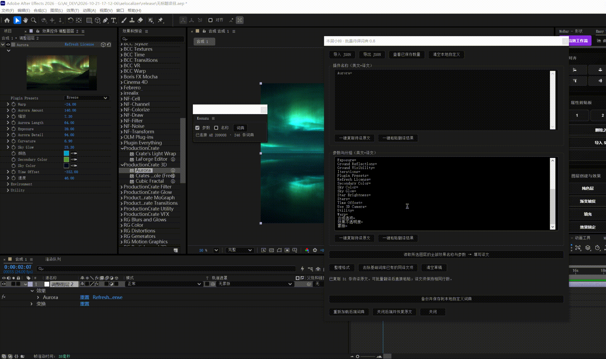

# 本居小铃 · Kosuzu
**拥有读懂任何文字的能力**

面向 Adobe After Effects 的本地词典汉化框架。用自己的词典翻译插件名称与参数文字，通过面板开关切换译文和原文。

**仅发布框架，默认不附带翻译词典。** 支持 Windows x64，当前以 After Effects 2026 为测试目标；Premiere Pro 暂未接入。
**Releases**提供了一键安装的版本，本项目不定期维护，本项目为GPT6sol+codex许愿式编程创建产物，目的其实仅本人日常使用。
## 下载与安装

前往 [Releases](https://github.com/fylm-233/Kosuzu/releases) 下载空词典 EXE 安装包或完整内容 ZIP。

1. 保存工程并关闭 AE，运行 EXE 安装包，允许管理员提权。使用 ZIP 时先解压，再双击 `Install.cmd`。
2. 启动 AE，从「窗口 → Kosuzu.jsx」打开面板，可拖动停靠。
3. 在 AE「首选项 → 脚本和表达式」中允许脚本写入文件。
4. 打开「词典」，导入或添加自己的译文，保存后开启「参数」「名称」开关。

后端随面板自动启动，运行时无需联网，不需安装 Node、Python、Frida、Java 或开发工具。

首次全新安装的四份词典均为 `{}`，安装后不会立即翻译。升级安装会保留本机已有的自定义词典，不会用空文件覆盖用户译文。

## 为什么不提供现成词典？

汉化参考可能涉及一些付费插件汉化组所享有的知识产权，因此本项目仅提供汉化框架，不提供现成翻译词典。建议自行添加汉化，或导入已经取得授权的词典。这部分可以自行去寻找一些在线的AI翻译，只要格式对上导入字库就行格式为：**English=英文**

添加与使用方法如下图：

## 自定义汉化

- **提取待译内容**：选中带有效果的图层，读取插件名称与参数；已有有效译文会自动排除。
- **直接编辑**：名称与参数分别使用连续多行编辑框，按 `English=译文` 格式批量填写。
- **批量复制粘贴**：点击「一键复制待译原文」，在其他软件翻译，保持顺序和行数，再点「一键粘贴翻译结果」。也可以粘贴完整的 `English=译文` 映射。
- **保存与重载**：保存前自动备份。空白译文和原文原样返回不作为有效翻译保存；行数不符或草稿改变时拒绝自动配对，避免错位。
- **切回原文**：关闭对应开关。若文字仍被 AE 缓存，可切换效果面板或折叠、展开参数。

词典为普通 JSON 对象，区分英文键的大小写，不会作为脚本执行。

| 文件 | 用途 |
| --- | --- |
| `Kosuzu.base.names.json` | 基础插件名称词典 |
| `Kosuzu.base.parameters.json` | 基础参数词典 |
| `Kosuzu.names.json` | 用户名称词典 |
| `Kosuzu.parameters.json` | 用户参数词典 |

安装后的词典位于 `%LOCALAPPDATA%\Kosuzu\app\dictionaries`。源码中的词典保持为空，发布时请勿混入自己的译文、运行日志或备份。

## 实现框架

| 层 | 技术与职责 |
| --- | --- |
| AE 面板 | ExtendScript / ScriptUI：停靠面板、开关、批量词典编辑 |
| 原生后端 | C++20 / Win32：进程连接、后台加载、状态维护 |
| 文字替换 | Windows DirectWrite：在共享工厂文字布局创建路径按本地词典替换文本 |
| 词典查找 | 不可变哈希表快照：本地精确匹配、模式切换、重载时切换词表 |
| 交互通信 | 按 AE 进程隔离的本地 JSON 请求与响应，面板异步等待确认 |
| 剪贴板 | Win32 Unicode 剪贴板助手 |
| 安装 | PowerShell + Windows 管理员提权，支持旧版识别、备份与用户词典迁移 |

原生组件使用静态 C++ 运行库。替换作用于显示文字，不修改工程参数值、表达式或第三方插件文件。

## 从源码构建

开发环境：Windows x64、Visual Studio C++ 工具及 Windows SDK。

1. 克隆仓库，运行 `Build-Native.cmd`。
2. 编译成功后，`backend` 下生成原生 DLL 和助手 EXE。
3. 保存工程、关闭 AE，运行 `Install.cmd` 安装。

`native` 包含后端及独立测试源码；`backend` 包含 JSON 编解码器和词典编辑器。可选 EXE 安装器引导源码为 `native/Setup.cpp`，封装时需嵌入内容 ZIP 资源。

## 当前限制

项目处于测试阶段。覆盖受插件绘制方式、独立工厂和 AE 缓存影响，不保证所有插件都能命中。当前版本只支持同时运行一个 AE 进程；面板回调修复、各插件交互及长期稳定性仍需持续测试。GIF 展示一种操作流程，不代表所有插件的兼容性。

反馈问题时请说明 AE 版本、插件名称和复现步骤；日志中的个人路径与工程信息请先移除。

## 许可证

框架代码采用 [MIT License](LICENSE)。不随项目分发任何第三方插件翻译词库；外部词典和第三方插件的权利归各自权利人所有。
本软件的“本居小铃”名取自《东方 Project》， 系上海爱丽丝幻乐团的既有作品角色，仅作软件命名致敬，与原作无关联。
